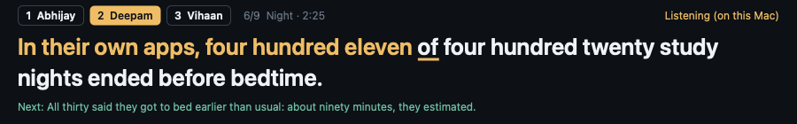

# Rested Prompter

A teleprompter strip that sits right under your webcam and follows your voice, so you can read your lines while looking at the camera. Made for recording our Rested app video: it has Abhijay's, Deepam's and Vihaan's scripts built in.



## Mac: install in one step

1. Open **Terminal**: press **⌘ Space**, type `Terminal`, press **Return**.
2. Paste this line and press **Return**:

```bash
curl -fsSL https://raw.githubusercontent.com/CoderAwesomeAbhi/rested-prompter/main/install.sh | bash
```

It downloads the app, puts it in Applications and opens it, with no security warning. Works on Apple Silicon and Intel Macs, macOS 11 or newer. To open it again later, find **Rested Prompter** in Applications or Spotlight.

<details>
<summary>Rather click a download link?</summary>

1. Download **[RestedPrompter-mac.zip](https://github.com/CoderAwesomeAbhi/rested-prompter/releases/latest/download/RestedPrompter-mac.zip)** and double-click it.
2. The first time, macOS blocks apps that aren't from the App Store: **Control-click** Rested Prompter, choose **Open**, then **Open** again.
3. If macOS says it "could not verify" the app: open **System Settings → Privacy & Security**, scroll down, click **Open Anyway**, then **Open**.

</details>

## Windows

Download **[RestedPrompter.exe](https://github.com/CoderAwesomeAbhi/rested-prompter/releases/latest/download/RestedPrompter.exe)** and double-click it. If Windows says "Windows protected your PC", click **More info → Run anyway**.

## Record your part

1. Press **1**, **2** or **3** (or click your name): 1 Abhijay, 2 Deepam, 3 Vihaan.
2. Start recording: Photo Booth or QuickTime Player → File → New Movie Recording on a Mac, the Camera app on Windows.
3. Click the strip once, press **V** and allow the microphone (and Speech Recognition on a Mac).
4. Look at the camera and read. Words you've said turn gold, the underlined word is next, and it moves to the next line by itself. Pause about 2 seconds between lines.

| Key | What it does |
| --- | --- |
| **V** | Follow my voice (on / off) |
| **A** | Auto pace, no voice needed |
| **Space** or **→** | Next line |
| **←** | Back a line |
| **R** | Restart this script |
| **1 / 2 / 3** or **Tab** | Switch person |
| **↑ / ↓** | Text size |
| **[ ]** | Lead: how far ahead of your voice the highlight runs |
| **Esc** | Quit |

Drag the strip to move it.

## If it doesn't hear you

- **Mac:** open **System Settings → Keyboard → Dictation**, turn it on, then press **V** again. Also check **System Settings → Privacy & Security → Microphone** and **Speech Recognition** are on for Rested Prompter.
- **Windows:** it uses Windows' built-in English (US) speech recognizer.
- Either way you can press **A** for auto pace or **Space** for each line.

## Build it yourself

- **Mac:** `bash mac/build-mac.sh` (needs Xcode's Command Line Tools: `xcode-select --install`). It makes `mac/Rested Prompter.app`.
- **Windows:** compile `windows/RestedPrompter.cs` with the .NET Framework compiler; the exact command is in `.github/workflows/build.yml`.

Every push builds both apps, runs the self-tests on a Mac (number handling, plus a simulated read of every script), publishes them to [Releases](https://github.com/CoderAwesomeAbhi/rested-prompter/releases/latest), and then installs the Mac app on fresh Macs with the one-line command above to check it opens.
